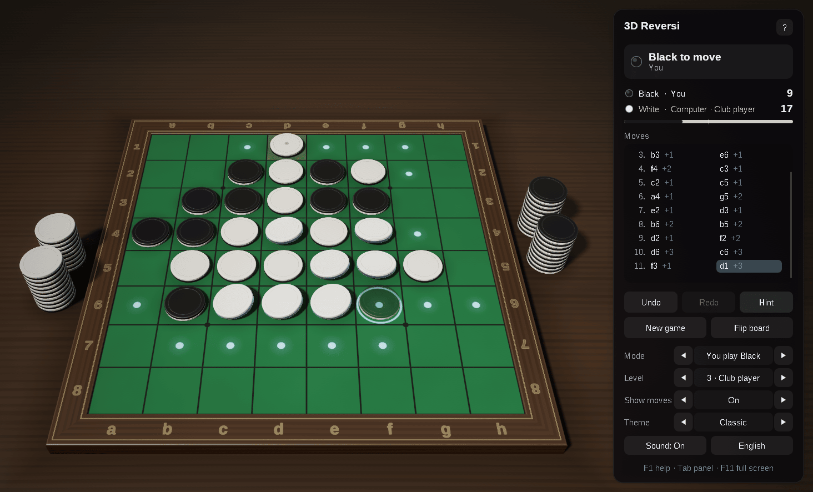
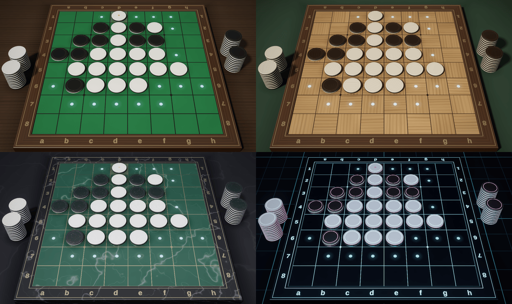

# 3D Reversi for macOS: Swift and Metal

[](https://github.com/sponsors/makarov-mm)
[](LICENSE)


[](https://www.linkedin.com/in/makarov-mm/)
[](https://www.threads.net/@m.m.makarov)
[](https://www.instagram.com/m.m.makarov/)

A 3D Reversi (Othello) game for macOS written in Swift on Metal and AppKit.

There is no game engine and no model, texture or sound file: the discs are turned on a lathe in code at startup, the materials are procedural, the lighting environment is baked on the GPU, and the sounds are synthesized. The only frameworks are the ones macOS has: AppKit for the window and the input, Metal and MetalKit for the graphics, Core Text for the text and AVFoundation for the sound. There are no package dependencies.

This is a port of the Linux version written in C++23 on SDL2 and OpenGL 4.6. The rules, the computer player, the scene and the animation follow it exactly, and its GLSL shaders are rewritten in the Metal Shading Language.





## Features

### Rules

- The standard rules: Black moves first from the four discs in the middle; a disc must bracket a line of the opponent's discs, which all turn over
- A side with no move passes, and the pass is announced; the game ends when neither side can move, and the most discs wins
- The squares are named as on a printed board, `a1` at the top left, so transcripts such as `f5d6c3d3c4` read the usual way

### Play

- A computer opponent with five levels, from Beginner to Master: iterative deepening, principal variation search and a transposition table, with an evaluation of mobility, frontier, corners, the squares next to them and stable discs; from 20 empty squares (at the top level) it plays the ending out exactly. It thinks in the background, so the window stays responsive
- Play Black, play White, two players on one computer, or watch a demo game
- The legal moves are marked; over one of them a see-through disc shows the move, and the discs it would turn lean towards turning and glow. The marks can be switched off
- Undo and redo, the move list with how many discs each move turned, the discs of each side and a bar of the score
- Hints: the suggested square is ringed
- Copy the game as a transcript or the position as a board string, and paste either to continue from it
- The game in progress, the settings and the window's frame are kept between sessions
- English and Russian interface and menus, chosen from the system language
- An about card with the author and links to his pages, which open in the browser
- Sound effects, mixed so that they can play over each other
- Full screen, and sharp on Retina displays: the interface and the text follow the scale of the screen the window is on
- Trackpad gestures: scroll or pinch to zoom; the zoom goes the same way with natural scrolling on or off
- Shortcuts work in any keyboard layout: by their letters in Latin layouts, by their places in others, such as the Russian one
- No work while nothing moves: the view stops drawing until something changes, and while the window is out of sight

### Graphics

- Physically based shading: GGX highlights, a clear lacquer coat, soft light inside the discs, image-based lighting from a procedural studio environment
- Soft shadows (PCSS), contact shadows, and the discs reflected in the polished boards
- HDR rendering with 4x MSAA, bloom, ACES tone mapping, vignette and dithering
- Smooth edges everywhere: multisampling for the outlines, and the grid lines, the dots and the marks drawn by the shaders filtered over each pixel; highlights widen where the surface curves within a pixel, so they do not sparkle
- Discs of two halves turned on a lathe, white on one face and black on the other, with a fine groove where they meet
- Animation: each disc flies from its player's stack beside the board to its square, then the discs it brackets turn over in a wave running out from it; a move taken back runs the other way, and a new game dissolves in
- Four themes: Classic (green baize), Walnut, Marble and Neon
- An interface of frosted-glass panels

## Controls

| Action | Control |
|---|---|
| Place a disc | Click a marked square |
| Turn the view | Drag with either mouse button |
| Zoom | Scroll, or pinch on a trackpad |
| Take back / replay a move | `⌘Z` / `⇧⌘Z`, `←` / `→`, `Delete` |
| Hint | `H` |
| New game | `N` |
| Flip the board | `F` |
| View from above | `V` |
| Reset the view | `Home` |
| Computer level | `1` … `5` |
| Who plays whom | `M` (`⇧M` back) |
| Show / hide the legal moves | `D` |
| Next theme | `T` (`⇧T` back) |
| Sound on / off | `S` |
| English / Russian | `L` |
| Show / hide the panel | `Tab` |
| Full screen | `⌃⌘F`, `F11`, `⌥Return` |
| Copy the game / the position | `⌘C` / `⇧⌘C` |
| Paste a game or a position | `⌘V` |
| Help | `F1`, `⌘?` |
| About the game and its author | `A` |
| Leave full screen | `Esc` |

The Control key works in place of Command in the shortcuts of the game, as Ctrl does on Linux.

## Requirements

- macOS 13 Ventura or newer, on Apple silicon or Intel
- Xcode 16 or newer, or its Command Line Tools: Swift 6 is needed to build

## Building and running

In the project's folder:

```sh
./build.sh          # builds build/3D Reversi.app
./build.sh run      # builds it and starts it
./build.sh clean    # removes the build output
```

The application is signed ad hoc, for the Mac it was built on; drag it to the Applications folder to keep it.

For a quick start without the application bundle:

```sh
swift run -c release
```

The settings and the game in progress are kept in the user defaults (`defaults read com.makarovmm.reversi3d`).

## Project structure

```text
.
├── Package.swift                the Swift package: one executable, the shaders and the icon as resources
├── build.sh                     builds and signs the application bundle
└── Sources/Reversi3D/
    ├── App/                     the application: the window, the menus, the view, the game flow, input and interface
    ├── Rules/                   the rules: bitboard move generation, notation, transcripts, the game record
    ├── Engine/                  the computer player: search, evaluation and the exact solver of the ending
    ├── Scene/                   the board and its frame, the disc on a lathe, the animation, the camera and the themes
    ├── Rendering/               the rendering pipeline: render targets, light probes, uniforms and the passes
    ├── Interface/               font atlases drawn with Core Text, the board's labels, drawing of the interface
    ├── Support/                 the settings, the texts in English and Russian, synthesized sound effects, the resources
    └── Resources/
        ├── Shaders/             Metal shaders, compiled when the game starts
        └── reversi3d.png        the icon
```

## How a frame is drawn

1. **Shadow map**: the discs seen from the key light, for soft shadows.
2. **Reflection**: the discs mirrored under the board, drawn at half resolution and blurred into mipmaps, so the polish of each theme can show a sharper or softer reflection.
3. **Main pass**: the table, the board and the discs in HDR with 4x MSAA, lit by the key light and the baked environment; the background is the environment itself, and the disc a click would place is blended over it all.
4. **Post-processing**: the samples are resolved, bright parts spread into a six-level bloom, and the composite pass applies tone mapping and vignetting and frosts the glass behind the interface panels.
5. **Interface**: panels, text and icons, drawn on top.

The environment maps are baked with compute kernels when the theme changes, and the BRDF table once at startup.

## License

MIT License

Copyright (c) 2026 Mykhailo Makarov

Permission is hereby granted, free of charge, to any person obtaining a copy
of this software and associated documentation files (the "Software"), to deal
in the Software without restriction, including without limitation the rights
to use, copy, modify, merge, publish, distribute, sublicense, and/or sell
copies of the Software, and to permit persons to whom the Software is
furnished to do so, subject to the following conditions:

The above copyright notice and this permission notice shall be included in all
copies or substantial portions of the Software.

THE SOFTWARE IS PROVIDED "AS IS", WITHOUT WARRANTY OF ANY KIND, EXPRESS OR
IMPLIED, INCLUDING BUT NOT LIMITED TO THE WARRANTIES OF MERCHANTABILITY,
FITNESS FOR A PARTICULAR PURPOSE AND NONINFRINGEMENT. IN NO EVENT SHALL THE
AUTHORS OR COPYRIGHT HOLDERS BE LIABLE FOR ANY CLAIM, DAMAGES OR OTHER
LIABILITY, WHETHER IN AN ACTION OF CONTRACT, TORT OR OTHERWISE, ARISING FROM,
OUT OF OR IN CONNECTION WITH THE SOFTWARE OR THE USE OR OTHER DEALINGS IN THE
SOFTWARE.

## Support

If you found this project interesting or useful, you can support my work:

[](https://github.com/sponsors/makarov-mm)
